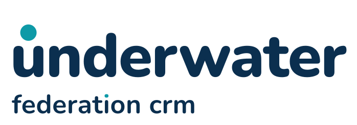
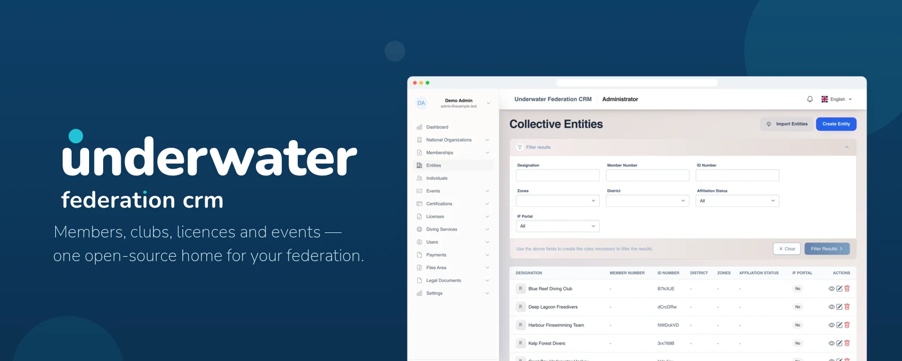
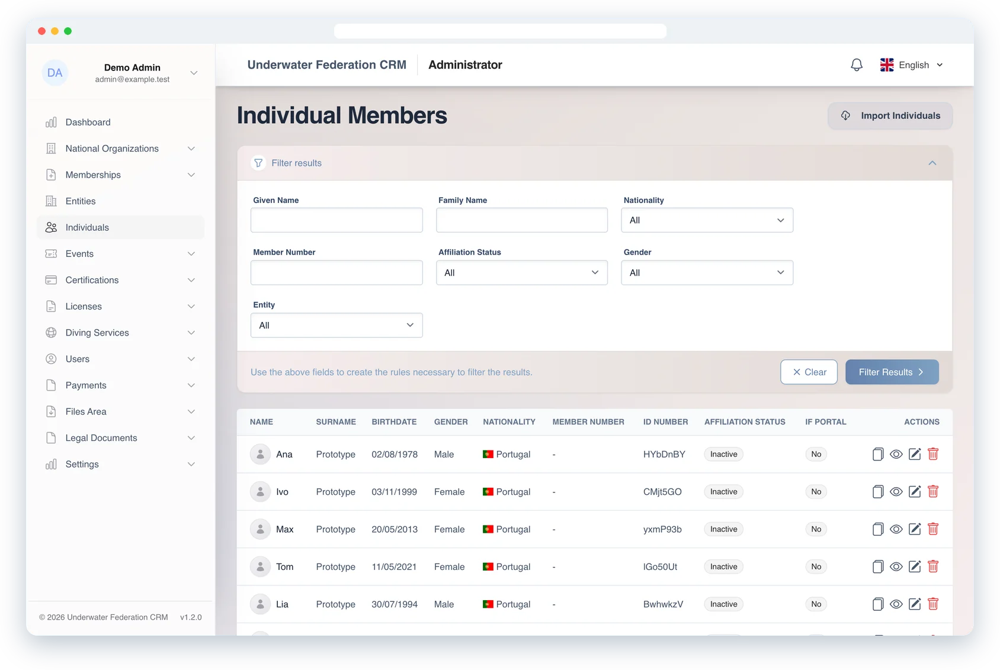
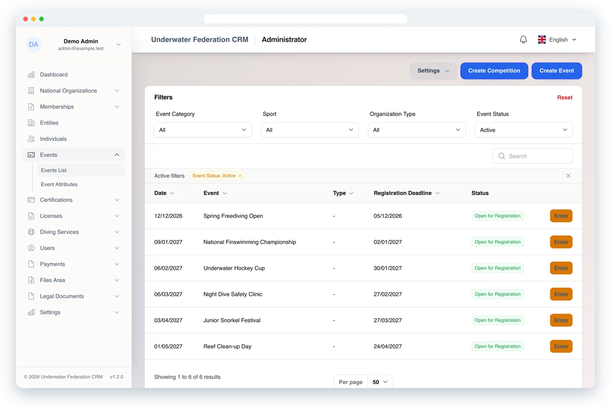
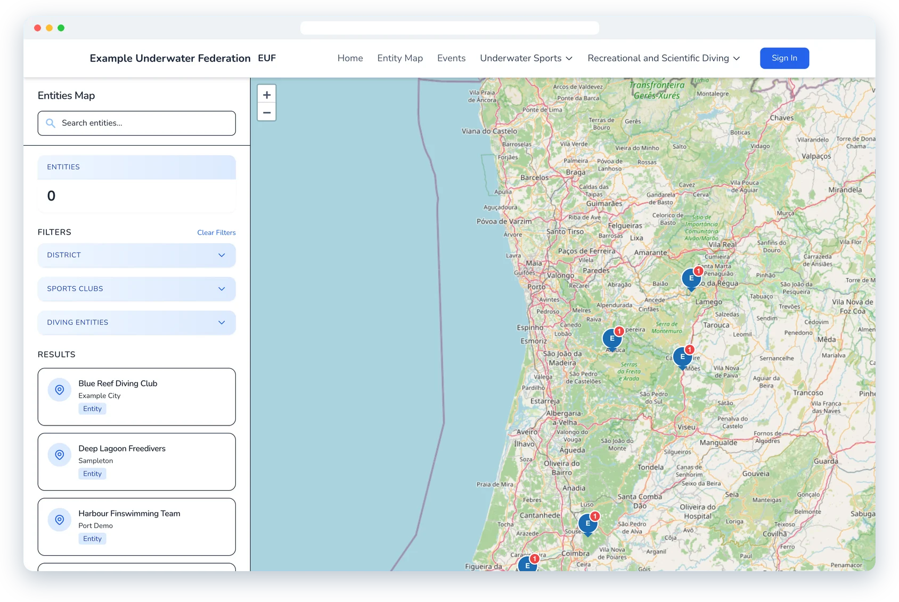
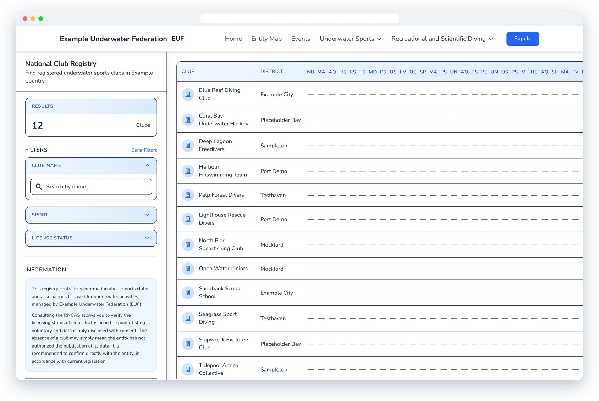
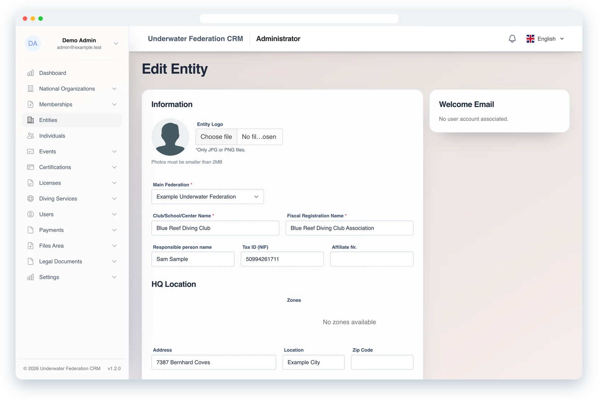
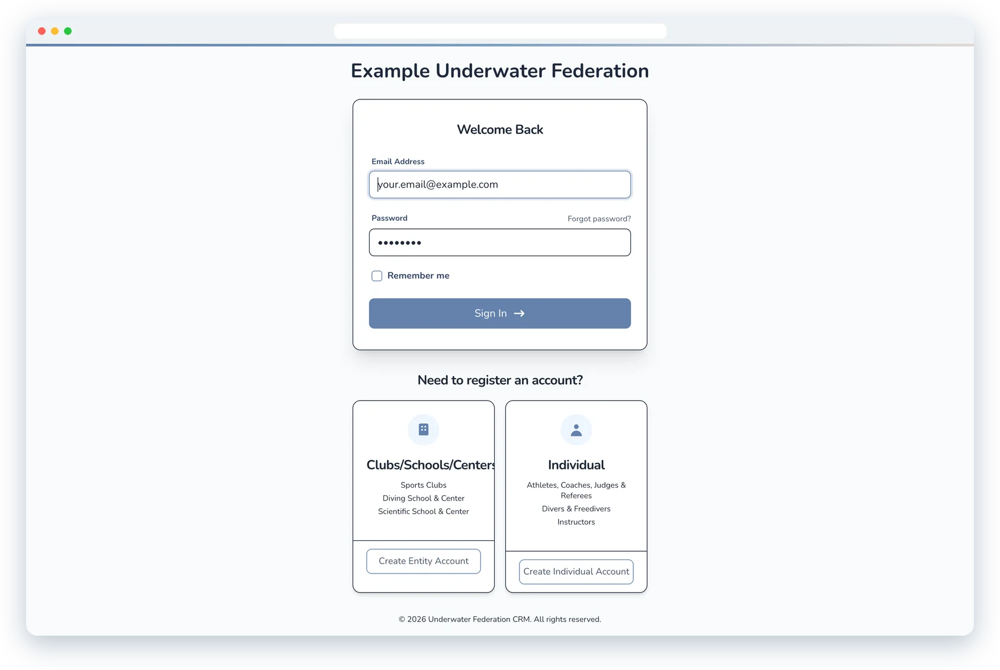

<div align="center">

<picture>
  <source media="(prefers-color-scheme: dark)" srcset="docs/public/brand/wordmark-reversed.svg">
  
</picture>

### The open-source operations platform for underwater-sport federations

Members, clubs, licences, certifications, events and payments, in one self-hosted Laravel app.

[](LICENSE)
[](https://github.com/DigitalFederation/UnderwaterFederationCRM/releases/latest)
[](https://laravel.com)
[](https://digitalfederation.github.io/UnderwaterFederationCRM/)

[**Documentation**](https://digitalfederation.github.io/UnderwaterFederationCRM/) ·
[**Getting started**](https://digitalfederation.github.io/UnderwaterFederationCRM/guides/getting-started) ·
[**Releases**](https://github.com/DigitalFederation/UnderwaterFederationCRM/releases) ·
[**Contributing**](.github/CONTRIBUTING.md)

<br>



</div>

<br>

## Why Underwater Federation CRM

Running a federation means keeping track of people, clubs, licences, certificates, competitions and the
payments that tie them together, usually across spreadsheets, email and a website. Underwater Federation
CRM puts that work in one place, with a portal for each role:

| Portal         | Who uses it                            | What they do                                                                          |
| -------------- | -------------------------------------- | ------------------------------------------------------------------------------------- |
| **Admin**      | Federation staff                       | Manage members, clubs, licences, certifications, events, documents and settings       |
| **Federation** | National or regional bodies            | Run their own members, clubs and competitions                                         |
| **Club**       | Clubs, schools and centres             | Register athletes, buy licences, enter events, manage their public page               |
| **Individual** | Athletes, coaches, instructors, judges | Keep their profile, licences and certificates up to date, and enrol in events         |
| **Public**     | Everyone                               | Find clubs on a map, check a club's licence, browse the coach and official registries |

It is built for underwater sports (diving, freediving, finswimming, underwater hockey and more), but
committees, licences and menus are configuration, so it adapts to other sports federations too.

## A look inside

<table>
  <tr>
    <td width="50%">
      
      <p align="center"><b>Members</b><br><sub>Every athlete, coach and official, with affiliation and licence status at a glance.</sub></p>
    </td>
    <td width="50%">
      
      <p align="center"><b>Events</b><br><sub>Competitions and courses with registration windows, disciplines and enrolment.</sub></p>
    </td>
  </tr>
  <tr>
    <td width="50%">
      
      <p align="center"><b>Public club map</b><br><sub>Licensed clubs on a map anyone can search. Map data © OpenStreetMap contributors.</sub></p>
    </td>
    <td width="50%">
      
      <p align="center"><b>Club registry</b><br><sub>A public, filterable register of clubs and the licences they hold.</sub></p>
    </td>
  </tr>
  <tr>
    <td width="50%">
      
      <p align="center"><b>Club profiles</b><br><sub>Legal details, locations, logo and the federation each club belongs to.</sub></p>
    </td>
    <td width="50%">
      
      <p align="center"><b>Self-service sign-up</b><br><sub>Clubs and individuals can register their own accounts.</sub></p>
    </td>
  </tr>
</table>

<sub>Screenshots use fictional demo data.</sub>

## Features

<table>
  <tr>
    <td width="33%" valign="top">
      <h4>👥 Members &amp; clubs</h4>
      Individuals, clubs and federations with role- and permission-based access, bulk import, and
      territorial assignment.
    </td>
    <td width="33%" valign="top">
      <h4>🪪 Licences &amp; certifications</h4>
      Purchase, attribution, renewal and validation flows, including international licences and
      professional roles.
    </td>
    <td width="33%" valign="top">
      <h4>🏆 Events</h4>
      Competitions and courses with disciplines, age groups, applications, enrolment of athletes,
      coaches and officials, and reports.
    </td>
  </tr>
  <tr>
    <td valign="top">
      <h4>💶 Documents &amp; payments</h4>
      Membership and licence fees, insurance, manual orders and invoices, with optional EasyPay
      payments and Moloni invoicing.
    </td>
    <td valign="top">
      <h4>🗺️ Public directories</h4>
      A public club map, club registry, coach and technical-official registries, and certification
      lookup.
    </td>
    <td valign="top">
      <h4>⚙️ Built to adapt</h4>
      Committees, menus and branding are configuration. Six languages included, and a plugin system for
      the rest.
    </td>
  </tr>
</table>

Committees (your federation's areas of activity, with their purchase, listing and menu wiring) live in
`config/committees.php`, so modelling your federation needs no code changes. See
[Configuring Committees](https://digitalfederation.github.io/UnderwaterFederationCRM/guides/configuring-committees).

## Quick start

**Requirements:** PHP 8.3+, Composer, Node.js 20.19+ (or 22.12+) and npm, and MySQL or a compatible database. Redis,
queues, object storage, mail, payments, Sentry and invoicing are optional and configured in `.env`.

Install a **release**, not `main`; see [Versions & updates](#versions--updates).

```bash
git clone --branch v2.0.0 https://github.com/DigitalFederation/UnderwaterFederationCRM.git
cd UnderwaterFederationCRM

composer install
npm ci
cp .env.example .env
php artisan key:generate
php artisan migrate --seed
npm run build
```

Run it locally:

```bash
php artisan serve   # http://127.0.0.1:8000
npm run dev         # Vite dev server (or use `npm run build` for static assets)
```

A fresh `migrate --seed` does **not** create a login account. To seed a first admin, set
`SEED_DEFAULT_ADMIN=true` and `DEFAULT_ADMIN_PASSWORD` in `.env` before seeding. The
**[Getting Started](https://digitalfederation.github.io/UnderwaterFederationCRM/guides/getting-started)**
guide covers the rest, including the scheduler (cron) and queue worker you need in production.

## Documentation

📖 **[Read the documentation »](https://digitalfederation.github.io/UnderwaterFederationCRM/)**
(also browsable in [`docs/`](docs/))

| Start with                                                                                                                                                                                                            | For                                                                        |
| --------------------------------------------------------------------------------------------------------------------------------------------------------------------------------------------------------------------- | -------------------------------------------------------------------------- |
| [Getting Started](https://digitalfederation.github.io/UnderwaterFederationCRM/guides/getting-started)                                                                                                                 | Installing, the first admin login, and production deployment               |
| [Using the Platform](https://digitalfederation.github.io/UnderwaterFederationCRM/using-the-platform/)                                                                                                                 | A tour of the admin, federation, club and individual portals               |
| [Configuring Committees](https://digitalfederation.github.io/UnderwaterFederationCRM/guides/configuring-committees)                                                                                                   | Defining your federation's areas of activity, the main customisation point |
| [Navigation & Menus](https://digitalfederation.github.io/UnderwaterFederationCRM/guides/navigation-and-menus)                                                                                                         | How the sidebar is built and customised                                    |
| [Architecture](https://digitalfederation.github.io/UnderwaterFederationCRM/architecture/01-overview) and [Access Control](https://digitalfederation.github.io/UnderwaterFederationCRM/access-control/role-management) | How the code and permissions are organised                                 |

## Configuration

All secrets and deployment-specific values belong in `.env`, never in committed files. Start from
`.env.example` and configure:

- application, database, cache, queue and mail settings;
- your federation's branding (`FEDERATION_*` and `INTERNATIONAL_FEDERATION_*`), including your own logo;
- the public map (`PUBLIC_MAP_*`);
- the optional EasyPay, Moloni, Sentry and object-storage integrations.

Locale, timezone, default country and the geography package installed at setup are controlled by
`APP_LOCALE`, `APP_TIMEZONE`, `DEFAULT_COUNTRY_CODE` and `GEOGRAPHY_DATASET`; see
[Localization and Geography](docs/guides/localization-and-geography.md). The full list is in the
[configuration reference](https://digitalfederation.github.io/UnderwaterFederationCRM/guides/getting-started#configuration).

Deployment-specific configuration, branding, logos, uploaded files, production data, business
documents and credentials must stay **outside** the repository.

## Versions & updates

Releases follow [Semantic Versioning](https://semver.org/) and are published as
[GitHub releases](https://github.com/DigitalFederation/UnderwaterFederationCRM/releases), each with
notes describing what changed. `CHANGELOG.md` in this repository carries the same history.

<details>
<summary><b>Install a specific release</b></summary>

```bash
git clone --branch v2.0.0 https://github.com/DigitalFederation/UnderwaterFederationCRM.git
```

Cloning at a tag leaves git in detached HEAD, which is correct for a deployment. Clone without
`--branch` only if you intend to run unreleased code from `main`.

</details>

<details>
<summary><b>Check which version you are running</b></summary>

```bash
php artisan version:check               # compares against the latest GitHub release
git describe --tags                     # e.g. v2.0.0
```

The version is also shown in the app's sidebar footer and on its **Version & Changelog** page.

A bare tag (`v2.0.0`) means you are on that release. Something like `v2.0.0-5-g168f401` means you
are 5 commits past it: a development snapshot of `main`, not a release.

</details>

<details>
<summary><b>Update to the latest release</b></summary>

```bash
git fetch --tags
git checkout $(git tag -l 'v*' --sort=-v:refname | head -n1)
composer install --no-dev --optimize-autoloader
npm ci && npm run build
php artisan filament:assets
php artisan migrate --force
php artisan optimize:clear && php artisan optimize
php artisan queue:restart
```

**Back up your database and `storage/` first**. Upgrading from 1.x to 2.0 also needs PHP 8.3; see
[Upgrading from 1.x to 2.0](https://digitalfederation.github.io/UnderwaterFederationCRM/guides/upgrading#upgrading-from-1-x-to-2-0).
Read the notes for every release between yours
and the target. The _Changed_ sections are where manual steps appear. The full procedure, including
rollback, is in the
**[Upgrading guide](https://digitalfederation.github.io/UnderwaterFederationCRM/guides/upgrading)**.

</details>

**To be notified** of new releases, choose **Watch → Custom → Releases** on this repository,
subscribe to the [release feed](https://github.com/DigitalFederation/UnderwaterFederationCRM/releases.atom),
or cron `php artisan version:check`. It exits `1` when an update is available and `2` if the check
itself failed, so monitoring can tell the two apart.

That command is the only thing that contacts GitHub, and only when you run it. The application never
phones home on its own, shows no update banner, and reports nothing about your installation.

## Testing & quality

```bash
php artisan test                                      # or ./vendor/bin/pest
./vendor/bin/phpstan analyse -c phpstan.neon
./vendor/bin/pint
npm run build
bash scripts/validate-no-generated-artifacts.sh --all
```

## Contributing

Contributions are welcome. Please read [`CONTRIBUTING.md`](.github/CONTRIBUTING.md) and
[`CODE_OF_CONDUCT.md`](.github/CODE_OF_CONDUCT.md) before opening an issue or pull request, and keep
private deployment details out of issues, commits and pull requests.

## Security

Please report vulnerabilities privately. See [`SECURITY.md`](.github/SECURITY.md).

## Support

Underwater Federation CRM is provided as source code for **self-hosting and adaptation**. The
maintainers do not provide guaranteed hosting, support, maintenance or service-level commitments.

## License

Licensed under the Apache License, Version 2.0. See [`LICENSE`](LICENSE).

The logo is set in [Nunito](https://github.com/googlefonts/nunito) (SIL Open Font License 1.1). Brand
files and usage notes are in [`resources/brand/`](resources/brand/).
